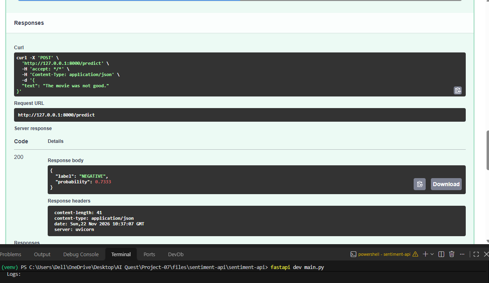

# GRU Sentiment Analysis API

A FastAPI service that classifies IMDB-style movie reviews as **POSITIVE** or **NEGATIVE**.

The model is the GRU from Class 23: `Embedding(10,002 × 100) → GRU(100 → 64, 1 layer) → Linear(64 → 1)`,
trained on the IMDB 50K reviews dataset (36,000 train / 4,000 validation / 10,000 test reviews).
On the held-out test set it reaches **87.9% accuracy** (test loss 0.32). The GRU reads the review word by word and the output after the
last real word is turned into a single score, which a sigmoid converts to P(positive). The API reuses the
**same vocabulary, tokenizer, 200-word truncation/padding and unknown-word handling** as the training notebook.

## Project structure

```
sentiment-api/
├── main.py           # FastAPI application (endpoints)
├── model.py          # GRUModel class (same architecture as the notebook)
├── predictor.py      # Loads artifacts once, preprocesses text, predicts
├── artifacts/
│   ├── gru_model.pt      # Trained weights (state_dict)
│   ├── word2idx.json     # Training vocabulary
│   └── config.json       # Model configuration (vocab_size, embed_dim, hidden_size, num_layers, max_len)
├── fork-of-class_23_Sentiment_Analysis_FULL_IMDB_GLOVE.ipynb   # Training notebook (+ artifact-saving cells)
├── requirements.txt
└── README.md
```

## API endpoints

| Method | Path       | Description                                            |
|--------|------------|--------------------------------------------------------|
| GET    | `/`        | API name and short description                         |
| GET    | `/health`  | Server status                                          |
| POST   | `/predict` | Body `{"text": "..."}` → predicted label + probability |

`probability` is the model's confidence in the **predicted** label (so a clearly negative review returns a
high probability with `"label": "NEGATIVE"`).

### Example prediction

```bash
curl -X POST http://127.0.0.1:8000/predict \
  -H "Content-Type: application/json" \
  -d '{"text": "This movie was absolutely amazing!"}'
```

```json
{"label": "POSITIVE", "probability": 0.91}
```

> Replace the output above with what your server actually returns for this review.

Another example (the notebook's GRU gave P(positive) = 0.267 for this review, so the API reports NEGATIVE with confidence 1 − 0.267):

```bash
curl -X POST http://127.0.0.1:8000/predict \
  -H "Content-Type: application/json" \
  -d '{"text": "The movie was not good."}'
```

```json
{"label": "NEGATIVE", "probability": 0.733}
```

Invalid input (missing/empty `text`, or text with no recognisable words) returns HTTP `422`.

## Run locally

```bash
# 1. (optional) create a virtual environment
python -m venv .venv
source .venv/bin/activate        # Windows: .venv\Scripts\activate

# 2. install dependencies
pip install -r requirements.txt

# 3. start the server
fastapi dev main.py
```

Then open **http://127.0.0.1:8000/docs** for the Swagger UI.

The model runs on CPU and is loaded once at startup, so no GPU and no retraining are needed.

### CPU-only PyTorch (smaller download)

```bash
pip install torch --index-url https://download.pytorch.org/whl/cpu
pip install "fastapi[standard]"
```

## Retraining / regenerating the artifacts

1. Run `fork-of-class-23-sentiment-analysis-full-977853496.ipynb` on Kaggle or Colab.
2. Run the final cells (section 16), which save `gru_model.pt`, `word2idx.json` and `config.json` to `artifacts/`.
3. Download those three files into this project's `artifacts/` folder.

All three files must come from the **same** training run.

## Swagger UI


